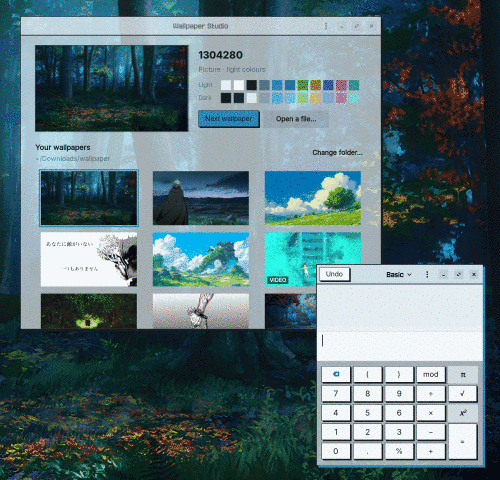
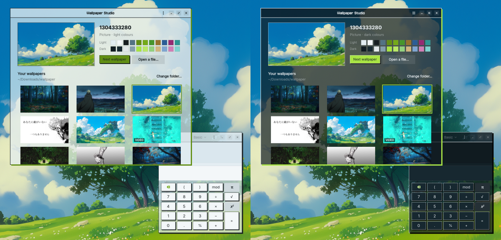
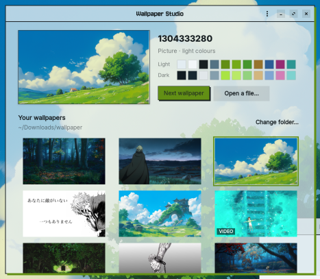

# trpStrata

Pick a wallpaper and your whole desktop takes its colours.



*Picking a wallpaper recolours the desktop and every open app on the spot. [Full-quality video](docs/demo.webm).*

- **Wallpapers:** pictures or looping videos, chosen from a folder of yours, with an optional new one every few hours.
- **Colours:** apps, GNOME Terminal and the lock screen are recoloured to match, in light, dark, or auto (light by day, dark at night).
- **One click back:** *Restore original look* puts every setting back the way it was.
- **Desktop widgets:** independently controlled clock, calendar, system and notes cards, with drag/resize and live CSS.
- **Terminal control:** inspect and change preferences with `trpstrata config` or `ws config`.

Made for the 42 iMacs (Ubuntu 22.04, GNOME, X11), where the normal desktop picture setting is locked.
No sudo needed.



*One wallpaper, two looks: light by day, dark at night (or pick one).*

## Install

Install this local checkout (no sudo needed):

```sh
cd ~/TrpStrata
./install.sh
```

Run the installer again to update. Later, open **trpStrata** from your apps (press Super and
type *trpStrata*) or run `trpstrata`. Use `./get.sh` to install and open it in one step.

## Storage on the school iMacs

When `~/goinfre` is available, installation automatically puts bulky files there:

```text
~/goinfre/trpstrata/
├── app/       installed Python code and bundled wallpapers
├── cache/     thumbnails, video poster frames and helper logs
└── themes/    downloaded adw-gtk3 themes
```

Rerun `./install.sh` to migrate an existing installation. Its small launcher and
compatibility links remain at `~/.local/share/trpstrata`,
`~/.cache/trpstrata` and `~/.local/share/themes/adw-gtk3*`, so existing commands,
autostart entries, wallpaper paths and CSS imports continue working. Files are copied
successfully before their former home directories are replaced with links.

Your layout, custom CSS/components, preferences and original desktop settings stay in
`~/.config/trpstrata`. Without goinfre, the installer uses the normal home
locations. An explicit `XDG_CACHE_HOME` remains authoritative for cache storage.
If the installed goinfre files are removed, rerun the installer; your saved settings
are kept separately. Your source checkout and personal wallpaper folders are not moved
by the installer; clone new checkouts into goinfre if you want those files there too.

Inspect the active locations with:

```sh
ws paths
```

## Run from source

In a GNOME **X11** terminal, run the checkout directly with Ubuntu's Python:

```sh
/usr/bin/python3 -m trp_strata
```

This uses your current source files without installing a copy. An already-running
desktop helper keeps its loaded code until restarted; `./install.sh` replaces the
installed copy and restarts that helper after widget or desktop code changes.

The Python dependencies are listed in [requirements.txt](requirements.txt).
GTK and libadwaita also need system libraries and introspection data. On an Ubuntu
machine where you have administrator access, install missing dependencies with:

```sh
sudo apt install python3-gi python3-cairo python3-gi-cairo python3-venv \
  gir1.2-gtk-3.0 gir1.2-gtk-4.0 gir1.2-adw-1 gir1.2-gdkpixbuf-2.0 \
  librsvg2-common libx11-6 libxtst6 dconf-cli uuid-runtime
```

On the school iMacs, these may already be provided; launching the app does not require
sudo. VLC (`sudo apt install vlc` on your own machine) is optional for video wallpapers.

For an isolated Python environment that reuses the system GTK bindings:

```sh
/usr/bin/python3 -m venv --system-site-packages .venv
source .venv/bin/activate
python -m pip install -r requirements.txt
python -m trp_strata
```

If environment creation fails at `ensurepip`, and Ubuntu already provides `pip` and
the GTK bindings, reuse them without bootstrapping pip:

```sh
/usr/bin/python3 -m venv --without-pip --system-site-packages .venv
source .venv/bin/activate
python -m pip install -r requirements.txt
python -m trp_strata
```

Use `/usr/bin/python3` to create this environment: a pyenv/Conda Python may not see
Ubuntu's bindings. Installing requirements with pip alone does not install GTK or
libadwaita. The PyGObject upper bound keeps pip compatible with Ubuntu 22.04's GLib;
see the [PyGObject system dependency table](https://pygobject.gnome.org/guide/sysdeps.html).

## How to use it



1. **Pick a folder.** The app comes with 16 wallpapers to start with;
    *Change folder…* points it at your own pictures and videos instead.
    Click *Refresh* beside it after downloading new wallpapers into that folder.
2. **Click a wallpaper.** The desktop changes and every open app takes its colours within a second.
   You can also drop a picture onto the window, or use *Open a file…*.
3. **Choose light, dark or auto** under *Colours*. Auto is light from 07:00 and dark from 19:00.
4. **Optional:** a new random wallpaper every few hours, see-through windows, the wallpaper on your
   lock screen, and *Keep screen awake* while you read or watch something.

To undo everything, open the menu (⋮) and choose *Restore original look*.

### Folder icons, top bar and dock colours

Wallpaper changes also generate matching folder icons and a GNOME Shell theme.
Folder icons use the wallpaper accent. Matching file icons distinguish documents,
PDFs, pictures, audio, video, archives, code, spreadsheets and presentations with
category symbols and wallpaper-tinted colours. Application logos inherit your original
icon theme. The top bar, menus, notifications and dock use the matching background and
text colours. Ubuntu Dock / Dash to Dock background overrides are updated too.

For the top bar and Shell menus, install and enable GNOME's **User Themes** extension
(on Ubuntu it is included in `gnome-shell-extensions`). Enable it in the Extensions
app, then pick a wallpaper again. Without that extension, GTK and folder colours
still work, but GNOME cannot load the generated Shell stylesheet.

In **GNOME Tweaks → Appearance**, the generated **trpStrata A/B** entries are
available for Applications, Icons and Shell. GNOME treats these as separate choices;
selecting only Applications does not change Icons or Shell. trpStrata selects
them together when applying a wallpaper, alternating A/B to refresh running apps.
*Restore original look* restores the previous icon, Shell and dock settings as well.

### Volume and brightness

Enable **Volume** and/or **Brightness** under **Desktop widgets**, then turn off
Arrange mode to use their sliders. Volume adjusts the default audio output from
0–100% and includes Mute/Unmute. Brightness controls the display exposed by GNOME's
power service. Changes from GNOME or keyboard shortcuts are picked up automatically.

Volume uses `pactl` (PulseAudio or PipeWire's PulseAudio service), falling back to
`wpctl` when pactl is absent. Brightness needs GNOME Settings Daemon and a supported
backlight; unsupported displays show an explanation instead of an active slider.

### Quick links

Enable **Quick links** under **Desktop widgets**. Click **Edit** beside its switch
to change the card title and add, rename or remove websites. **Save** updates the
desktop card; **Cancel** discards edits. Links open in your default browser.
The starter links are 42 Intra and GitHub. Addresses without a scheme use HTTPS.
Website favicons load in the background directly from each site's homepage/icon
links and are cached locally for seven days. Unavailable icons fall back to a browser
icon; cached icons remain usable offline.
Leave Arrange mode to click the shortcuts.

### Fuzzy file search

Enable **File search** under **Desktop widgets**, then leave Arrange mode to type.
Search by filename, abbreviation (`rpt` for `report`), spelling approximation, or
words from a relative path. The six best matches show file-type icons and their
containing folders; click one to open it in its default application.

The widget indexes your home folder in the background, without reading file contents.
It skips hidden entries, symlinks, caches and common build/dependency directories.
Click **Refresh** after adding, moving or deleting files. The in-memory index is
limited to 50,000 files (and 200,000 scanned entries); a status message reports limits.
To search a smaller folder, set the FileSearch widget's `props` in
`~/.config/trpstrata/layout.json`, for example `{"root": "~/Documents"}`.

### Editing notes

In **Desktop widgets**, click **Edit** beside a Notes widget. Change its title and
multiline text, then click **Save** to update the desktop card. **Cancel** discards
your edits. Each Notes widget is edited independently, keeping its position and size.

### App launcher widget

Under **Widgets**, enable **App launcher** (and **Show desktop widgets**). Turn off
**Arrange widgets** to click its app buttons. The launcher follows your GNOME dock
favourites; the search box finds installed applications by name, description or
desktop ID. Clear the search to return to favourites. App buttons show their system
icons above their titles in a three-column grid with consistent dimensions; long names are shortened and shown in full in
tooltips. Changes to installed apps and favourites are picked up automatically.

To pin a different list, edit the launcher's `props` in
`~/.config/trpstrata/layout.json`, using desktop-file IDs from
`/usr/share/applications` or `~/.local/share/applications`:

```json
"props": {
  "title": "My apps",
  "apps": ["org.gnome.Nautilus.desktop", "org.gnome.Terminal.desktop", "firefox.desktop"],
  "page_size": 6
}
```

Omit `apps` to follow GNOME favourites again. App launch errors appear on the card.

## Your own style

Write your own style in `~/.config/gtk-3.0/gtk.css` and `gtk-4.0/gtk.css`. trpStrata only adds one
line at the top of the GTK 4 file and keeps everything else. Use these colours there and your style follows
every wallpaper:

| Name | What it is |
|---|---|
| `@ws_paper`, `@ws_paper2`, `@ws_sheet` | backgrounds: window, header bars, content |
| `@ws_ink`, `@ws_muted` | text, secondary text |
| `@ws_accent`, `@ws_accent_text`, `@ws_on_accent` | the accent, accent-coloured text, text on the accent |
| `@ws_shadow` | a hard shadow colour (ink by day, black at night) |

For example, sharp corners with an accent shadow under every window:

```css
* { border-radius: 0; }
window.csd { box-shadow: 0 0 0 2px @ws_ink, 5px 5px 0 1px @ws_accent; }
```

## Recolour other tools (hooks)

After every recolour, trpStrata runs each executable file in `~/.config/trpstrata/hooks/`
(in the background, in name order). The colours for the current mode are in environment variables:

| Variable | Value |
|---|---|
| `WS_MODE` | `light` or `dark` |
| `WS_PAPER`, `WS_PAPER2`, `WS_SHEET`, `WS_INK`, `WS_MUTED` | backgrounds and text, as `#RRGGBB` |
| `WS_ACCENT`, `WS_ACCENT_TEXT`, `WS_ON_ACCENT` | the accent colours |
| `WS_ANSI_0` … `WS_ANSI_15` | a 16-colour terminal palette |
| `WS_STATE` | path to `state.json`, with both the light and dark palettes |

For example, `~/.config/trpstrata/hooks/kitty` (made executable with `chmod +x`):

```sh
#!/bin/sh
printf 'background %s\nforeground %s\ncursor %s\n' "$WS_PAPER" "$WS_INK" "$WS_ACCENT" > ~/.config/kitty/wallpaper.conf
pkill -USR1 kitty
```

## Command line

For an interactive terminal control panel, run:

```sh
ws tui
# Or directly from this checkout:
.venv/bin/python -m trp_strata tui
```

The LazyGit-style layout stacks five navigation panels on the left: **Wallpapers**,
**Appearance**, **Widgets**, **Screen** and **Tools**. The selected panel expands, while
the right pane shows item details and a live text preview of clock formats. Command
output stays visible below it. Editing and confirmation use centred popups.

Browse/select wallpapers, edit every preference, control keep-awake, edit CSS, view
helper logs, or restore your desktop from one place. Each left panel remembers its
selection when you switch away and return.

| Key | Action |
|---|---|
| `1`–`5`, Tab / Shift-Tab | Change left panel |
| Right / `l` / `6` | Focus the preview/details pane |
| Left / `h` | Return to the selected left panel |
| Up/Down or `j`/`k` | Select an item or scroll the focused preview |
| `g` / `G`, Page Up / Page Down | Jump or page through the focused pane |
| Enter, Space or `e` | Edit, toggle or apply the selected item |
| `/`, then text | Filter wallpaper filenames |
| Escape | Cancel an edit or clear the wallpaper filter |
| `n` | Next random wallpaper |
| `r` | Refresh settings and the wallpaper library |
| `v` | Read the full result/error from the last action |
| `?` | Show help |
| `q` | Close the panel; the desktop helper keeps running |

Text fields support Left/Right, Home/End, Backspace/Delete and Ctrl-U to clear. CSS
editing uses `VISUAL`, then `EDITOR`, then `nano`. Restore and reset require typing a
confirmation. Slower wallpaper/theme changes run in a child process, allowing continued
navigation; a change already in progress can finish after you close the panel.

The TUI uses Python's built-in `curses`; no additional pip dependency is needed. It
needs an interactive terminal of at least 60 columns by 16 rows. Preferences can be
edited without an X11 display and will apply at the next desktop-helper startup;
wallpaper playback and desktop integrations need the graphical session.

```
trpstrata                  open the window
trpstrata tui              interactive terminal control panel
trpstrata paths            show actual app, cache and configuration paths
trpstrata set FILE         use a picture or video
trpstrata next             a random different one from your folder
trpstrata light|dark|auto  colour mode
trpstrata restore          undo everything
trpstrata clock on|off     show or hide the desktop clock
trpstrata layout edit|done arrange desktop widgets
trpstrata layout toggle ID toggle one widget independently
trpstrata awake 60         keep awake for 60 minutes (on/off also supported)
trpstrata config list      list preferences and descriptions
trpstrata config get KEY   read a preference
trpstrata config set KEY VALUE
                                 validate, save and apply a preference
trpstrata config reset [KEY]
                                 reset one preference, or all preferences
trpstrata status           configuration, wallpaper state and awake request as JSON
```

The installer also creates `~/.local/bin/ws` as a shortcut, unless you already have a
command there. Put `~/.local/bin` on your `PATH` if needed. Examples:

```sh
ws config set folder ~/Pictures/Wallpapers
ws config set rotate_hours 0.5
ws config set glass true
ws config set light_from 8
ws config set dark_from 20
ws config set clock_format '%H:%M:%S'
ws config set clock_top 48
```

Configuration commands work without a graphical session; changes apply at the next
helper startup. With a running desktop, commands apply immediately and the open
control panel follows the saved preferences. `config path` prints the configuration path.
Equal light/dark hours mean always dark; schedules can also cross midnight.

For optional Bash/Zsh aliases (`ws`, `wnext`, `wawake`, `wclock`), run:

```sh
eval "$(trpstrata shell-init)"
```

Add that line to your shell startup file to keep them. The installer leaves startup
files alone. `./install.sh --no-start` installs without launching the helper immediately;
the login autostart entry is still installed.

## Desktop widgets and live CSS

The desktop uses one transparent layout with macOS-inspired **Clock, Calendar, System
stats, Notes and Logtime** cards. Each has its own on/off switch in the graphical control panel
and TUI, including custom widgets added to the layout.

Cards use the wallpaper palette with translucent glass, accent highlights, softened
wallpaper backdrops and drop shadows. Toggle **Frosted widget glass** in the GUI/TUI,
or use `ws config set widget_blur false`. Adjust strength with
`ws config set widget_blur_radius 24` (0–64). The Gaussian blur is sampled from the wallpaper;
videos use their poster frame. It does not require a compositor extension.

```sh
ws layout edit        # drag inside to move; resize any edge/corner; scroll to scale text
ws layout done        # finish arranging; only widget buttons accept clicks
ws layout list
ws layout toggle calendar
ws layout reset       # replace placements with the default five-card layout
```

Cards move while you drag, and positions/scales save on release. Scales range from
0.5 to 2.5. Normal mode stays below app windows; arrange mode raises the cards and
accepts input only over them. The master **Show desktop widgets** switch preserves each
card's individual choice.

The **Logtime** card shows your 1337 hours with a progress ring and Prev/Next month controls.
Configure its login and target in the GUI/TUI, or run:

```sh
ws config set logtime_username sel-mlil
ws config set logtime_goal 180
```

October means October 28–November 27; the active period rolls over on the 28th. Fetching happens in the background and
results are cached in goinfre when available. See the [Logtime guide](docs/widgets.md#logtime)
for adding the card to a custom layout, per-instance settings and CSS classes.

Customize `~/.config/trpstrata/layout.json` for positions, anchors, scale,
visibility and props. Edit `widgets.css` in that directory for appearance; both reload
live. Use `em` units so your styles scale with the card:

```css
#widget-clock .clock-time {
  font-family: monospace;
  font-size: 3.8em;
  color: @ws_accent;
}
```

GTK CSS handles appearance; web placement properties such as `position`, `top`, Flexbox
and Grid are handled instead by the desktop layout. Add your own component file to
`~/.config/trpstrata/widgets/`, export a `@component` function named `Widget`, and
reference its filename in `layout.json`. No core registration is needed. See the
[widget guide](docs/widgets.md) for a complete example and the GTK API reading path.
User files survive updates; `XDG_CONFIG_HOME` is respected. Edit `app.css` for the GTK 4
control panel; the desktop components use GTK 3 in a separate process.

Keep-awake now combines GNOME inhibition with a periodic XTEST mouse movement from the
current position to `(0, 0)` and back. It sends no clicks or keys, skips held keys/buttons,
and requires an active, unlocked session. Use `ws config set awake_method inhibit` for
GNOME-only inhibition. Old `key` settings migrate to `mouse`. Synthetic input still
needs testing against the school's idle monitor. See `~/.cache/trpstrata/helper.log`
for diagnostics. Restore hides all widgets and stops keep-awake.

## Uninstall

```sh
./uninstall.sh
```

It restores your original look first, then removes the app.

## How it works

| Part | What it does |
|---|---|
| `trp_strata/palette.py` | Reads the picture at a tiny size and picks an accent colour (the picture's most vivid colour that stands out) plus neutrals tinted with its overall colour, in a light and a dark set. |
| `trp_strata/core.py` | Applies them: a small GTK theme ("trpStrata A"/"B" in `~/.local/share/themes`, adw-gtk3 underneath plus your colours), the light/dark setting, a GNOME Terminal profile, and the lock-screen picture. Saves your original settings first. GTK only re-reads a theme when its name changes, so each recolour flips between the two identical copies and open apps restyle live. |
| `trp_strata/desktop.py` | A small helper started at login. GNOME's own wallpaper is locked at 42, so it draws the wallpaper in a desktop window behind everything. Pictures cost almost nothing once drawn. Videos play through VLC and pause when a window is maximised or the screen is locked. It also handles the rotation timer and the auto light/dark switch. |
| `trp_strata/app.py` | The window (GTK 4 + libadwaita). |
| `trp_strata/tui.py` | Interactive curses terminal controls; actions reuse the CLI in background processes. |
| `trp_strata/media.py` | Shared image/video discovery without GTK imports. |
| `trp_strata/settings.py`, `storage.py`, `cli.py` | Validated preferences, atomic persistence, shared locking and terminal commands; configuration inspection needs no GTK. |
| `trp_strata/widgets/`, `styles/` | Clock, calendar, system and notes components, macOS-inspired card CSS and live user overrides. |
| `trp_strata/components.py`, `gtk_renderer.py`, `widget_runtime.py`, `layout.py` | Component rendering, a shared desktop canvas, custom-widget loading, live drag/resize, and persisted layout. |
| `trp_strata/awake.py` | Optional XTEST pointer round trips while keep-awake is active. |
| `trp_strata/glass.py` | Cached wallpaper softening and CSS-shaped glass backdrops for the cards. |

Preferences and generated colours live in `~/.config/trpstrata`. On machines with
goinfre, installed code/wallpapers, previews/logs and downloaded themes live under
`~/goinfre/trpstrata`; the usual home paths are compatibility links. `ws paths`
prints the selected paths.
It also writes generated themes in `~/.local/share/themes`, a GTK 4 CSS import,
launcher/autostart files, GNOME settings and session files in `XDG_RUNTIME_DIR`.

Older GTK 3 apps (Files, Terminal…) take the colours through the
[adw-gtk3](https://github.com/lassekongo83/adw-gtk3) theme, which `install.sh` downloads into
`~/.local/share/themes` if you don't have it.

## Limits

- Open GTK 3 apps (Files, Terminal, Calculator…) and the trpStrata window recolour instantly.
  Other libadwaita apps (Settings, Text Editor…) only read their colours when they start, so they change
  the next time you open them.

- X11 sessions only (the default at 42).
- Videos need VLC and use more memory than pictures (about 75–130 MB while playing).
